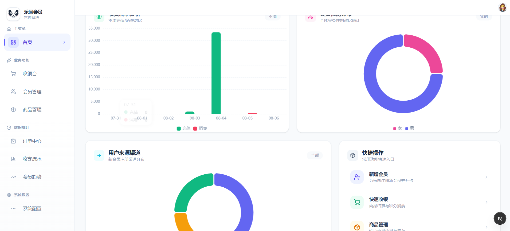

# 星光儿童乐园 · 会员管理与收银系统

基于 Next.js 16 + Cloudflare Workers/D1 全栈构建的儿童乐园会员管理与收银系统。



## 技术栈

| 分类 | 技术 |
|------|------|
| 框架 | [Next.js 16](https://nextjs.org/) (App Router) |
| 运行时 | [Cloudflare Workers](https://workers.cloudflare.com/) / [OpenNext](https://opennext.js.org/) |
| 数据库 | Cloudflare D1 (SQLite) |
| 语言 | TypeScript |
| 样式 | [Tailwind CSS v4](https://tailwindcss.com/) |
| 图表 | [ECharts](https://echarts.apache.org/) |
| 图标 | [Lucide React](https://lucide.dev/) |
| 认证 | JWT (jose, HS256, 24h) |
| HTTP | Axios |

## 功能模块

### 仪表盘
- 关键指标概览：会员总数、今日销售额、总积分、活跃率
- 可视化图表：会员增长趋势、交易金额趋势、性别分布、渠道分布

### 会员管理
- 会员列表分页展示，支持按姓名/手机号搜索
- 新增/编辑会员：姓名、手机号、性别、地址、渠道、卡类型、到期时间
- 余额/积分调整（手动增减，自动记录交易流水）
- 会员状态管理（active / disabled）

### 商品管理
- 商品 CRUD：名称、物品编码、普通价、会员价、商品图片
- 上架/下架控制，支持批量操作
- 图片上传（拖拽 + 点击，支持 JPG/PNG/GIF/WebP，≤2MB）
- 卡片式布局，双价格展示

### 收银台
- 已上架商品网格展示，勾选加入结算清单
- 输入会员手机号查询 → 校验会员身份
  - 查到会员 → 切换会员价，展示会员信息卡片
  - 未查到 → 提示错误，仍可按原价购买
- 两种结算方式：
  - **原价购买**：普通价格结算，创建订单
  - **会员价购买**：会员价结算，扣减余额 → 创建订单 → 写入交易流水
- 余额不足时会员价按钮自动置灰
- 购买成功自动打印入园票据（含当日入园人数序号 NO.XX）
- 入园人数每日按票种独立计数，次日归零

### 订单中心
- 订单列表分页展示，支持按订单号/会员筛选
- 订单详情（订单明细、价格快照、操作人）
- 区分散客票与会员票，展示扣款前后余额

### 交易流水
- 交易记录列表：会员信息、类型（余额/积分）、金额、余额快照
- 按类型/会员搜索，分页展示

### 统计分析
- 会员增长趋势：按日期范围展示新注册会员趋势
- 收支流水统计：按日期范围展示收入/支出趋势，支持指定会员

### 系统设置 (others)
- AI 助手：调用大模型对话
- 员工管理：员工 CRUD，支持角色分配（admin / super_admin）

### 个人中心
- 修改用户名、头像、密码、手机号、地址

### 认证系统
- JWT Token 认证，登录/注册
- 路由守卫：未登录自动跳转，Token 过期自动处理

## 项目结构

```
├── migrations/
│   └── 0001_init.sql              # 数据库初始化迁移
├── public/                        # 静态资源
├── src/
│   ├── app/
│   │   ├── layout.tsx             # 根布局
│   │   ├── globals.css            # 全局样式
│   │   ├── (main)/                # 主业务路由（需登录）
│   │   │   ├── layout.tsx         # Sidebar + Header + AuthGuard
│   │   │   ├── page.tsx           # 仪表盘
│   │   │   ├── members/           # 会员管理
│   │   │   ├── products/          # 商品管理
│   │   │   ├── cashier/           # 收银台
│   │   │   ├── transactions/      # 交易流水
│   │   │   ├── statistics/
│   │   │   │   ├── members/       # 会员增长统计
│   │   │   │   ├── transactions/  # 收支流水统计
│   │   │   │   └── orders/        # 订单中心
│   │   │   ├── profile/           # 个人中心
│   │   │   └── others/            # 系统设置（AI + 员工管理）
│   │   ├── login/                 # 登录页
│   │   ├── register/              # 注册页
│   │   └── api/                   # API 路由
│   │       ├── auth/              # 登录/注册
│   │       ├── dashboard/         # 仪表盘统计
│   │       ├── members/           # 会员 CRUD + 余额调整
│   │       ├── products/          # 商品 CRUD + 上下架
│   │       ├── cashier/           # 收银台（商品列表/会员查询/结算/入园统计）
│   │       ├── orders/            # 订单列表/详情
│   │       ├── transactions/      # 交易流水
│   │       ├── statistics/        # 数据统计（会员/收支）
│   │       ├── user/profile/      # 个人资料
│   │       ├── users/             # 员工管理
│   │       ├── cron/              # 定时任务（会员过期检查）
│   │       └── debug/             # 测试数据种子
│   ├── components/                # 公共组件
│   │   ├── AuthGuard.tsx          # 路由守卫
│   │   ├── Dashboard.tsx          # 仪表盘
│   │   ├── Header.tsx             # 顶部导航
│   │   ├── Sidebar.tsx            # 侧边导航
│   │   ├── ToastProvider.tsx      # Toast 通知
│   │   ├── UserDropdown.tsx       # 用户下拉菜单
│   │   └── TableSkeleton.tsx      # 表格骨架屏
│   ├── lib/                       # 工具库
│   │   ├── axios.ts               # HTTP 客户端（自动 Token + 401 处理）
│   │   └── utils/
│   │       ├── jwt.ts             # JWT 签名/验证
│   │       ├── password.ts        # SHA-256 密码哈希
│   │       ├── response.ts        # 统一响应格式
│   │       ├── logger.ts          # 操作日志
│   │       └── time.ts            # 中国时区工具
│   ├── index.ts                   # Cloudflare Worker 入口
│   └── proxy.ts                   # API 认证中间件
├── wrangler.jsonc                 # Cloudflare 配置
├── next.config.ts
└── package.json
```

## 数据库表结构

| 表名 | 说明 | 关键字段 |
|------|------|----------|
| `users` | 系统用户 | id, username, password_hash, role, phone, address |
| `members` | 会员信息 | id, name, phone, cardcode, balance, points, gender, status, cartype, expired_at |
| `transactions` | 交易流水 | id, member_id, order_id, type, amount, balance_before, balance_after |
| `products` | 商品 | id, name, code, regular_price, member_price, image, status |
| `orders` | 订单主表 | id, order_no, member_id, operator_id, price_type, total_amount, balance_before, balance_after |
| `order_items` | 订单明细 | id, order_id, product_id, sold_price, quantity, subtotal |
| `entry_counts` | 入园计数 | id, entry_date, product_id, product_name, count |
| `product_operation_logs` | 操作日志 | id, target_type, target_id, action, content |

### ER 关系

```
┌──────────┐     ┌──────────────┐     ┌─────────────┐
│ members  │────→│    orders    │────→│ order_items │←── products
│ (会员)   │ 可选 │  (订单)     │ 1:N │ (订单明细)  │
└────┬─────┘     └──────┬──────┘     └─────────────┘
     │                  │
     │ 1:N              │ 0..1 (仅会员价)
     │                  │
┌────▼──────────┐       │
│ transactions  │←──────┘
│  (交易流水)   │
└───────────────┘
```

## 快速开始

### 前置要求

- Node.js 18+
- Wrangler CLI (`npm i -g wrangler`)

### 1. 安装依赖

```bash
npm install
```

### 2. 数据库迁移

```bash
# 本地执行
npx wrangler d1 execute nextjs-db --local --file=migrations/0001_init.sql

# 远程（生产环境）
npx wrangler d1 execute nextjs-db --remote --file=migrations/0001_init.sql
```

### 3. 生成测试数据

```bash
curl -X POST http://localhost:3000/api/debug/seed
```

> 自动生成 50 个会员及随机交易数据。

### 4. 启动开发服务器

```bash
npm run dev
```

访问 http://localhost:3000

### 默认账户

| 用户名 | 密码 | 角色 |
|--------|------|------|
| admin | admin123 | super_admin |

## API 接口

通用响应格式：

```json
{ "code": 200, "message": "success", "data": {} }
```

| code | 说明 |
|------|------|
| 200 | 成功 |
| 400 | 参数校验失败 |
| 401 | 未登录 / Token 过期 |
| 404 | 资源不存在 |
| 500 | 服务器内部错误 |

### 认证

| 方法 | 路径 | 说明 |
|------|------|------|
| POST | `/api/auth/login` | 用户登录 |
| POST | `/api/auth/register` | 用户注册 |

### 仪表盘

| 方法 | 路径 | 说明 |
|------|------|------|
| GET | `/api/dashboard/stats` | 仪表盘统计数据 |

### 会员管理

| 方法 | 路径 | 说明 |
|------|------|------|
| GET | `/api/members` | 会员列表（分页+搜索） |
| POST | `/api/members` | 新增会员 |
| PUT | `/api/members` | 编辑会员 |
| DELETE | `/api/members` | 删除会员 |
| POST | `/api/members/adjust` | 余额/积分调整 |

### 商品管理

| 方法 | 路径 | 说明 |
|------|------|------|
| GET | `/api/products` | 商品列表（分页+筛选） |
| POST | `/api/products` | 上架商品 |
| PUT | `/api/products` | 编辑商品 |
| DELETE | `/api/products` | 删除商品 |
| PUT | `/api/products/status` | 批量上架/下架 |

### 收银台

| 方法 | 路径 | 说明 |
|------|------|------|
| GET | `/api/cashier/products` | 已上架商品列表 |
| POST | `/api/cashier/member/lookup` | 查询会员（手机号/姓名） |
| POST | `/api/cashier/checkout` | 确认结算（原价/会员价） |
| GET | `/api/cashier/entry-counts` | 今日入园人数统计 |

### 订单

| 方法 | 路径 | 说明 |
|------|------|------|
| GET | `/api/orders` | 订单列表/详情 |

### 交易流水

| 方法 | 路径 | 说明 |
|------|------|------|
| GET | `/api/transactions` | 交易流水列表 |

### 数据统计

| 方法 | 路径 | 说明 |
|------|------|------|
| GET | `/api/statistics/members` | 会员增长趋势 |
| GET | `/api/statistics/transactions` | 收支流水统计 |

### 用户/员工

| 方法 | 路径 | 说明 |
|------|------|------|
| GET | `/api/user/profile` | 获取个人资料 |
| PUT | `/api/user/profile` | 修改个人资料 |
| GET | `/api/users` | 员工列表 |
| POST | `/api/users` | 新增员工 |
| PUT | `/api/users` | 编辑员工 |
| DELETE | `/api/users` | 删除员工 |

### 调试与定时

| 方法 | 路径 | 说明 |
|------|------|------|
| POST | `/api/debug/seed` | 生成测试数据 |
| GET | `/api/cron/check-expired` | 检查过期会员 |

## 业务规则

| 规则 | 说明 |
|------|------|
| 价格体系 | 每个商品设置普通价和会员价，会员价 ≤ 普通价 |
| 收银结算 | 不填会员按原价购买（不扣余额）；填会员且校验通过按会员价购买（扣余额+写流水） |
| 余额校验 | 会员价合计 ≤ 余额方可扣款，否则按钮置灰 |
| 价格快照 | 订单明细冗余存储商品名称和价格，历史订单不受后续商品修改影响 |
| 交易流水 | 仅会员价消费写入 `transactions`；原价购买仅写 `orders` + `order_items` |
| 入园计数 | 每种票每日独立编号，下单成功自动累加，次日归零 |
| 票据打印 | 结算成功后自动打印入园票据，票面显示当日累计入园序号 |
| 角色权限 | super_admin 可管理员工；admin 为普通管理员 |

## 脚本

| 命令 | 说明 |
|------|------|
| `npm run dev` | 启动开发服务器 |
| `npm run build` | 构建 |
| `npm run deploy` | 构建并部署到 Cloudflare Workers |
| `npm run preview` | 构建并本地预览 Cloudflare 部署 |
| `npm run lint` | ESLint 检查 |
| `npm run cf-typegen` | 生成 Cloudflare 环境类型声明 |
